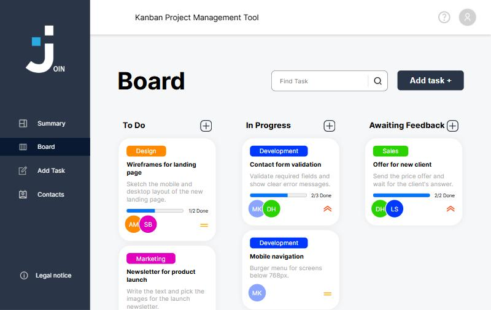

# Join – Kanban-Taskmanager

> **Bootcamp-Projekt (Developer Akademie)**

**Live-Demo:** _[LIVE-LINK FOLGT]_

<!-- TODO Luka: Gruppenprojekt? Falls ja, Team und eigenen Anteil hier ergänzen, z. B. "Gruppenprojekt mit X und Y. Mein Teil: Board, Drag & Drop, Summary." -->



Join ist ein Kanban-Taskmanager im Browser. Aufgaben lassen sich erstellen, Kontakten zuweisen, priorisieren und per Drag & Drop durch die Spalten *To Do*, *In Progress*, *Awaiting Feedback* und *Done* schieben.

## Funktionen

- Login, Registrierung und Gast-Login
- **Summary:** Übersicht mit Anzahl Aufgaben pro Status, dringende Aufgaben und nächste Deadline
- **Board:** Kanban-Board mit Drag & Drop (Desktop) und «Move Task»-Buttons (Mobile), Suche nach Titel und Beschreibung
- **Aufgaben:** erstellen, bearbeiten, löschen, mit Kategorie, Priorität, Fälligkeitsdatum und Subtasks inklusive Fortschrittsbalken
- **Kontakte:** anlegen, bearbeiten, löschen, alphabetisch gruppiert

## Technik

- HTML, CSS und reines JavaScript (ohne Framework)
- Header und Navigation werden als HTML-Templates per `fetch` nachgeladen (`w3-include-html`)
- Datenspeicherung im `localStorage` des Browsers (siehe unten)

## Datenspeicherung

Alle Daten bleiben **nur im eigenen Browser** gespeichert. Beim ersten Besuch zeigt die App Demo-Daten (Kontakte, Kategorien, Aufgaben), damit das Board nicht leer ist. Sobald man etwas speichert, arbeitet die App mit den eigenen Daten weiter.

Der Login ist eine reine Frontend-Demo ohne Server: Bitte **keine echten Passwörter** verwenden.

## Überarbeitung 2026

Ursprünglich speicherte Join alle Daten auf dem Remote-Storage-Server der Developer Akademie. Dieser Server ist nicht mehr nutzbar (abgelaufenes TLS-Zertifikat), dadurch konnte die App weder laden noch speichern. Bei der Überarbeitung wurde Folgendes gemacht:

- Speicherung auf `localStorage` umgestellt, mit gleicher Schnittstelle (`setItem` / `getItem`), damit der restliche Code unverändert bleibt
- Demo-Daten für den ersten Besuch ergänzt, Deadlines relativ zum heutigen Datum
- Fehler behoben: Telefonnummern mit Leerzeichen liessen sich beim Bearbeiten eines Kontakts nicht speichern (`\s` in einem Template-String)
- Fehler behoben: «Upcoming Deadline» zeigte auch Deadlines von erledigten Aufgaben
- Falschen relativen Bildpfad in `contact.css` korrigiert

## Lokal starten

Die Templates werden per `fetch` geladen, darum braucht es einen lokalen Webserver (ein Doppelklick auf `index.html` reicht nicht):

```bash
npx serve .
```

oder

```bash
python -m http.server 8000
```

Danach `http://localhost:3000` bzw. `http://localhost:8000` öffnen. Alternativ funktioniert die VS-Code-Erweiterung «Live Server».
